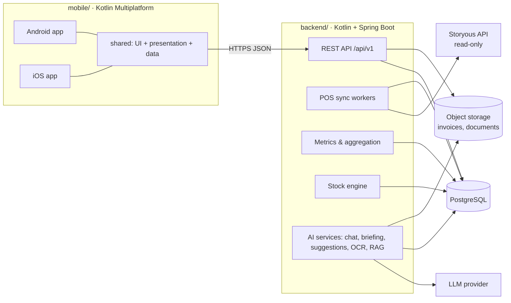

# Architecture

> **Status: to be discussed.** This page holds the *proposed defaults* agents may use to get
> started, and the decisions that are still open. Settled decisions become ADRs in
> [`adr/`](adr/), and this page links to them.

## System overview (proposed)

## Proposed defaults

| Area | Default | Notes |
|------|---------|-------|
| Repo | Monorepo: `backend/`, `mobile/`, `docs/` | **Decided** |
| Doc language | English | **Decided** |
| Design | Cross-platform direction (single UI for Android + iOS) | **Decided** |
| Backend language | Kotlin (JVM 25 LTS) | **Decided** |
| Backend framework | Spring Boot 4.x (4.2 at project start) | **Decided** |
| Backend style | Modular monolith (account, pos, reporting, stock), Spring Modulith, schema per module | **Decided** · [ADR 0009](adr/0009_BACKEND_MODULAR_MONOLITH.md) |
| Database | PostgreSQL + Flyway migrations | **Decided** · [ADR 0002](adr/0002_POSTGRES_FLYWAY_JOOQ.md) |
| Persistence | jOOQ, no JPA/Hibernate; hourly rollup tables for reports | **Decided** · [ADR 0002](adr/0002_POSTGRES_FLYWAY_JOOQ.md) |
| Jobs | db-scheduler (PostgreSQL-backed) | **Decided** · [ADR 0009](adr/0009_BACKEND_MODULAR_MONOLITH.md) |
| Mobile | Kotlin Multiplatform | **Decided** |
| Mobile UI | Compose Multiplatform (shared UI for Android and iOS) | **Decided** · [ADR 0003](adr/0003_COMPOSE_MULTIPLATFORM_UI.md) |
| Mobile arch | MVVM/UDF: ViewModel + immutable `UiState` + `StateFlow` | Proposed |
| Networking | Ktor client + kotlinx.serialization | Proposed |
| DI | Koin | Proposed |
| Offline | Read-only cache everywhere; offline stock counts with outbox sync | **Decided** · [ADR 0006](adr/0006_OFFLINE_STRATEGY.md) |
| Local DB | SQLDelight | Proposed (ADR 0006) |
| Real-time | Foreground polling + ETag for live data; SSE for assistant answers | **Decided** · [ADR 0005](adr/0005_POLLING_AND_SSE.md) |
| Navigation | Compose Navigation (multiplatform) or Voyager/Decompose | Open |
| API contract | OpenAPI 3.1, contract-first, code generated on both sides, no shared Kotlin module | **Decided** · [ADR 0001](adr/0001_OPENAPI_CONTRACT_FIRST.md) |
| Auth | Own JWT (access + refresh), Apple/Google ID-token verification, email OTP | **Decided** · [ADR 0004](adr/0004_OWN_JWT_AUTH.md) |
| AI (first release) | Receipt extraction only: Claude Haiku 5.5 vision + structured output, Sonnet 5.5 fallback | **Decided** · [ADR 0007](adr/0007_RECEIPT_EXTRACTION_WITH_CLAUDE.md) |
| AI (assistant, later) | Chat, briefing, RAG; provider and privacy approach decided when built | Open |
| Vector store | pgvector in the same Postgres (only when the assistant needs it) | Proposed |
| Files | S3-compatible storage behind `FileStorage` (MinIO locally, free tier at first) | **Decided** · [ADR 0008](adr/0008_HETZNER_HOSTING_ZERO_COST_START.md) |
| Hosting | One Hetzner VM (Docker Compose: Caddy, backend, PostgreSQL), nightly off-site backups | **Decided** · [ADR 0008](adr/0008_HETZNER_HOSTING_ZERO_COST_START.md) |
| CI/CD | GitHub + GitHub Actions, images on GHCR, deploy over SSH | **Decided** · [ADR 0008](adr/0008_HETZNER_HOSTING_ZERO_COST_START.md) |

## Decisions to discuss

1. ~~Compose Multiplatform vs native SwiftUI~~ → decided in [ADR 0003](adr/0003_COMPOSE_MULTIPLATFORM_UI.md).
2. ~~Shared Kotlin code between backend and mobile~~ → decided in [ADR 0001](adr/0001_OPENAPI_CONTRACT_FIRST.md).
3. ~~Persistence approach and report aggregation~~ → decided in [ADR 0002](adr/0002_POSTGRES_FLYWAY_JOOQ.md).
4. Sync architecture: polling vs webhooks (depends on what the Storyous API offers) and per-venue scheduling. Job queue → db-scheduler ([ADR 0009](adr/0009_BACKEND_MODULAR_MONOLITH.md)).
5. ~~Real-time~~ → decided in [ADR 0005](adr/0005_POLLING_AND_SSE.md).
6. ~~Offline behaviour~~ → decided in [ADR 0006](adr/0006_OFFLINE_STRATEGY.md).
7. ~~Multi-tenancy model~~ → decided in [ADR 0009](adr/0009_BACKEND_MODULAR_MONOLITH.md) (venue-scoped methods + access check per use case; no RLS for now).
8. ~~LLM for the first release~~ → decided in [ADR 0007](adr/0007_RECEIPT_EXTRACTION_WITH_CLAUDE.md).
   Assistant provider and privacy (pseudonymisation / DPA / EU-only inference) remain open until
   the assistant is built.
9. ~~Hosting, environments, CI/CD~~ → decided in [ADR 0008](adr/0008_HETZNER_HOSTING_ZERO_COST_START.md).
10. ~~Auth~~ → decided in [ADR 0004](adr/0004_OWN_JWT_AUTH.md).

## ADRs

Write one file per decision: `adr/NNNN_SHORT_TITLE.md`, using [`adr/0000_TEMPLATE.md`](adr/0000_TEMPLATE.md).

| ADR | Title | Status |
|-----|-------|--------|
| [0001](adr/0001_OPENAPI_CONTRACT_FIRST.md) | OpenAPI contract-first, no shared Kotlin module | Accepted |
| [0002](adr/0002_POSTGRES_FLYWAY_JOOQ.md) | PostgreSQL + Flyway + jOOQ (no JPA) | Accepted |
| [0003](adr/0003_COMPOSE_MULTIPLATFORM_UI.md) | Compose Multiplatform for the shared UI | Accepted |
| [0004](adr/0004_OWN_JWT_AUTH.md) | Own JWT auth with Apple, Google and email codes | Accepted |
| [0005](adr/0005_POLLING_AND_SSE.md) | Polling for live figures, SSE for chat streaming | Accepted |
| [0006](adr/0006_OFFLINE_STRATEGY.md) | Read-only offline cache, offline stock counting | Accepted |
| [0007](adr/0007_RECEIPT_EXTRACTION_WITH_CLAUDE.md) | Receipt extraction with Claude Haiku 5.5 | Accepted |
| [0008](adr/0008_HETZNER_HOSTING_ZERO_COST_START.md) | Hosting on Hetzner, starting at near-zero cost | Accepted |
| [0009](adr/0009_BACKEND_MODULAR_MONOLITH.md) | Backend architecture: modular monolith with Spring Modulith | Accepted |
