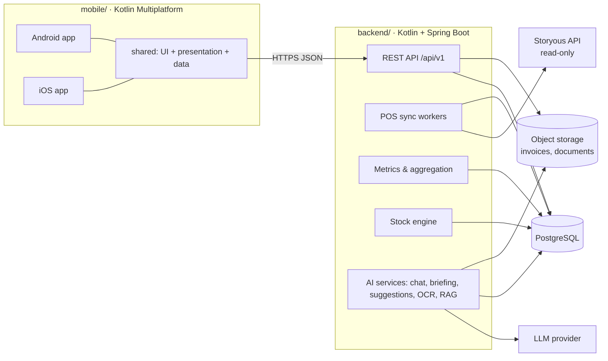

# Architecture

> **Status: to be discussed.** This page holds the *proposed defaults* agents may use to get
> started, and the decisions that are still open. Settled decisions become ADRs in
> [`adr/`](adr/), and this page links to them.

## System overview (proposed)

## Proposed defaults

| Area | Default | Notes |
|------|---------|-------|
| Repo | Monorepo: `backend/`, `mobile/`, `docs/` | **Decided** |
| Doc language | English | **Decided** |
| Design | Cross-platform direction (single UI for Android + iOS) | **Decided** |
| Backend language | Kotlin (JVM 25 LTS) | **Decided** |
| Backend framework | Spring Boot 4.x (4.2 at project start) | **Decided** |
| Backend style | Modular monolith (account, pos, reporting, stock), Spring Modulith, schema per module | **Decided** · [ADR 0009](adr/0009_BACKEND_MODULAR_MONOLITH.md); internal structure [ADR 0013](adr/0013_BACKEND_MODULE_STRUCTURE.md) (proposed) |
| Database | PostgreSQL + Flyway migrations | **Decided** · [ADR 0002](adr/0002_POSTGRES_FLYWAY_JOOQ.md) |
| Persistence | jOOQ, no JPA/Hibernate; hourly rollup tables for reports | **Decided** · [ADR 0002](adr/0002_POSTGRES_FLYWAY_JOOQ.md) |
| Jobs | db-scheduler (PostgreSQL-backed) | **Decided** · [ADR 0009](adr/0009_BACKEND_MODULAR_MONOLITH.md) |
| Mobile | Kotlin Multiplatform | **Decided** |
| Mobile UI | Compose Multiplatform (shared UI for Android and iOS) | **Decided** · [ADR 0003](adr/0003_COMPOSE_MULTIPLATFORM_UI.md) |
| Mobile arch | crew-kmp structure: feature × layer modules, ViewModel + State/Action/Event, Koin, typed Navigation Compose, generated API models in `core:api` | **Decided** · [ADR 0011](adr/0011_MOBILE_ARCHITECTURE.md) |
| Networking | Ktor client + kotlinx.serialization, handwritten requests on generated models | **Decided** · [ADR 0011](adr/0011_MOBILE_ARCHITECTURE.md) |
| DI | Koin (+ graph verification test) | **Decided** · [ADR 0011](adr/0011_MOBILE_ARCHITECTURE.md) |
| Offline | Read-only cache everywhere; offline stock counts with outbox sync | **Decided** · [ADR 0006](adr/0006_OFFLINE_STRATEGY.md) |
| Local storage | DataStore; Room only for offline counting | **Decided** · [ADR 0011](adr/0011_MOBILE_ARCHITECTURE.md) |
| Real-time | Foreground polling + ETag for live data; SSE for assistant answers | **Decided** · [ADR 0005](adr/0005_POLLING_AND_SSE.md) |
| Navigation | Navigation Compose with typed routes | **Decided** · [ADR 0011](adr/0011_MOBILE_ARCHITECTURE.md) |
| API design | Hybrid (BFF dashboards + REST stock), UUIDv7, minor-unit money, RFC 9457 + codes, PUT + version, Idempotency-Key | **Decided** · [ADR 0010](adr/0010_API_DESIGN.md) |
| API contract | OpenAPI 3.0.3, contract-first, code generated on both sides, no shared Kotlin module | **Decided** · [ADR 0001](adr/0001_OPENAPI_CONTRACT_FIRST.md) |
| Auth | Own JWT (access + refresh), Apple/Google ID-token verification, email OTP | **Decided** · [ADR 0004](adr/0004_OWN_JWT_AUTH.md) |
| AI (first release) | Receipt extraction only: Claude Haiku 5.5 vision + structured output, Sonnet 5.5 fallback | **Decided** · [ADR 0007](adr/0007_RECEIPT_EXTRACTION_WITH_CLAUDE.md) |
| AI (assistant, later) | Chat, briefing, RAG; provider and privacy approach decided when built | Open |
| Vector store | pgvector in the same Postgres (only when the assistant needs it) | Proposed |
| Files | S3-compatible storage behind `FileStorage` (MinIO locally, free tier at first) | **Decided** · [ADR 0008](adr/0008_HETZNER_HOSTING_ZERO_COST_START.md) |
| Hosting | One Hetzner VM (Docker Compose: Caddy, backend, PostgreSQL), nightly off-site backups | **Decided** · [ADR 0008](adr/0008_HETZNER_HOSTING_ZERO_COST_START.md) |
| CI/CD | GitHub + GitHub Actions, images on GHCR, deploy over SSH | **Decided** · [ADR 0008](adr/0008_HETZNER_HOSTING_ZERO_COST_START.md) |

## Decisions to discuss

1. ~~Compose Multiplatform vs native SwiftUI~~ → decided in [ADR 0003](adr/0003_COMPOSE_MULTIPLATFORM_UI.md).
2. ~~Shared Kotlin code between backend and mobile~~ → decided in [ADR 0001](adr/0001_OPENAPI_CONTRACT_FIRST.md).
3. ~~Persistence approach and report aggregation~~ → decided in [ADR 0002](adr/0002_POSTGRES_FLYWAY_JOOQ.md).
4. Sync architecture: polling vs webhooks (depends on what the Storyous API offers) and per-venue scheduling. Job queue → db-scheduler ([ADR 0009](adr/0009_BACKEND_MODULAR_MONOLITH.md)).
5. ~~Real-time~~ → decided in [ADR 0005](adr/0005_POLLING_AND_SSE.md).
6. ~~Offline behaviour~~ → decided in [ADR 0006](adr/0006_OFFLINE_STRATEGY.md).
7. ~~Multi-tenancy model~~ → decided in [ADR 0009](adr/0009_BACKEND_MODULAR_MONOLITH.md) (venue-scoped methods + access check per use case; no RLS for now).
8. ~~LLM for the first release~~ → decided in [ADR 0007](adr/0007_RECEIPT_EXTRACTION_WITH_CLAUDE.md).
   Assistant provider and privacy (pseudonymisation / DPA / EU-only inference) remain open until
   the assistant is built.
9. ~~Hosting, environments, CI/CD~~ → decided in [ADR 0008](adr/0008_HETZNER_HOSTING_ZERO_COST_START.md).
10. ~~Auth~~ → decided in [ADR 0004](adr/0004_OWN_JWT_AUTH.md).
11. Transactional email provider (sign-in codes): open until hosting is set up (phase 7). The backend
    sends over plain SMTP behind `EmailSender`, so it is configuration only. Candidates with EU data
    processing: **Scaleway TEM** (lean: 300/month free, then €0.25 per 1,000, no branding), Brevo
    (300/day free, but a Brevo footer on the free plan), Lettermint. Resend keeps account data and logs
    in the US, so it does not meet ADR 0008. Verify terms at signup.
12. Revoking Sign in with Apple on account deletion: Apple expects apps to revoke the user's Apple
    tokens (REST `/auth/revoke`) when the account is deleted. That needs the authorization code from
    the app at sign-in, an exchange for an Apple refresh token stored per identity, and a client
    secret signed with an Apple `.p8` key (a new secret). `DELETE /me` currently deletes our side
    only (the user can remove the app in Apple ID settings). Decide before App Store review.

## Database

Schema: [DB_SCHEMA.md](DB_SCHEMA.md) (`platform`, `account`, `pos`, `reporting` accepted; `stock` pending).

## ADRs

Write one file per decision: `adr/NNNN_SHORT_TITLE.md`, using [`adr/0000_TEMPLATE.md`](adr/0000_TEMPLATE.md).

| ADR | Title | Status |
|-----|-------|--------|
| [0001](adr/0001_OPENAPI_CONTRACT_FIRST.md) | OpenAPI contract-first, no shared Kotlin module | Accepted |
| [0002](adr/0002_POSTGRES_FLYWAY_JOOQ.md) | PostgreSQL + Flyway + jOOQ (no JPA) | Accepted |
| [0003](adr/0003_COMPOSE_MULTIPLATFORM_UI.md) | Compose Multiplatform for the shared UI | Accepted |
| [0004](adr/0004_OWN_JWT_AUTH.md) | Own JWT auth with Apple, Google and email codes | Accepted |
| [0005](adr/0005_POLLING_AND_SSE.md) | Polling for live figures, SSE for chat streaming | Accepted |
| [0006](adr/0006_OFFLINE_STRATEGY.md) | Read-only offline cache, offline stock counting | Accepted |
| [0007](adr/0007_RECEIPT_EXTRACTION_WITH_CLAUDE.md) | Receipt extraction with Claude Haiku 5.5 | Accepted |
| [0008](adr/0008_HETZNER_HOSTING_ZERO_COST_START.md) | Hosting on Hetzner, starting at near-zero cost | Accepted |
| [0009](adr/0009_BACKEND_MODULAR_MONOLITH.md) | Backend architecture: modular monolith with Spring Modulith | Superseded by 0013 (when accepted) |
| [0010](adr/0010_API_DESIGN.md) | API design rules | Accepted |
| [0011](adr/0011_MOBILE_ARCHITECTURE.md) | Mobile architecture: crew-kmp structure with generated API models | Accepted |
| [0012](adr/0012_CROSS_CUTTING_CONCERNS.md) | Cross-cutting: logging, environments, i18n, analytics, flags, testing, branches | Accepted |
| [0013](adr/0013_BACKEND_MODULE_STRUCTURE.md) | Backend module internal structure (replaces 0009) | Proposed |
