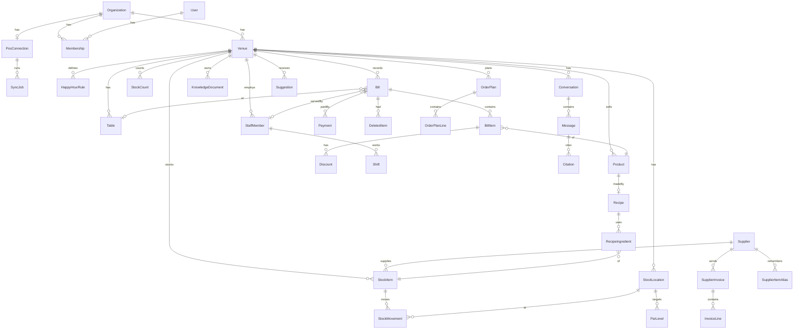

# Domain model

Logical model. It is a **draft**: the persistence design (tables, indexes, partitioning) will be
finalised in the architecture discussion. Field lists show what the screens need, not a final
schema.

## Modules and contexts

Backend modules are defined in [ADR 0009](../architecture/adr/0009_BACKEND_MODULAR_MONOLITH.md).
Each module owns one PostgreSQL schema.

| Module (schema) | Owns | Source of data |
|-----------------|------|----------------|
| `account` | Organization, User, Membership, app roles, sessions/refresh tokens, **Venue**, followed venues | Our app (venues registered by the POS sync) |
| `pos` | PosConnection, SyncJob, external ID mapping, raw payloads; POS read model: Bill, BillItem, Payment, Discount, DeletedItem, Refund, Product, Category, HappyHourRule, Table, TableZone, StaffMember, Shift | Storyous (read-only, immutable copy) |
| `reporting` | Hourly rollups and metric queries over `pos` data (reads `pos` tables, writes only its own) | Derived |
| `stock` | StockItem, StockLocation, ParLevel, StockMovement, Receipt (SupplierInvoice) + lines, SupplierItemAlias, StockCount, Transfer/PullList, Recipe, Supplier | Our app (user input + computed) |
| *(later)* `assistant` | Conversation, Message, Citation, Briefing, Suggestion, Insight, KnowledgeDocument | Our app + LLM |

`pos` data is a **read model of the POS**: never edited by users. `account` and `stock` hold **our
own** data. The field lists below are grouped by topic, not by module.

## Entities

## Key fields

### Identity

- **Organization**: `id`, `name`, `createdAt`.
- **User**: `id`, `email`, `displayName`, `authProviders[] (APPLE|GOOGLE|EMAIL)`, `locale`.
- **Membership**: `userId`, `organizationId`, `role (OWNER|STAFF)`, `venueIds[]` (venues the user
  follows / may access), `staffMemberId?` (link to POS staff member, for staff users).

### POS integration

- **PosConnection**: `id`, `organizationId`, `provider (STORYOUS)`, `status
  (PENDING|ACTIVE|ERROR|REVOKED)`, encrypted credentials, `lastSyncedAt`.
- **SyncJob**: `id`, `connectionId`, `kind (INITIAL|INCREMENTAL|BACKFILL)`, `steps[]` with
  `name`, `state (WAITING|RUNNING|DONE|FAILED)`, `progress%`, `countLabel`.
- **External ID mapping**: every synced entity keeps `externalId` + `provider`; upserts are
  idempotent by `(provider, externalId)`.

### Sales (read model)

- **Venue**: `id`, `organizationId`, `name`, `district`, `timeZone`, `currency`,
  `businessDayStart` (e.g. `05:00` cut-off, see metrics), `externalId`.
- **Bill**: `id`, `venueId`, `number`, `tableId?`, `staffMemberId?`, `openedAt`, `closedAt?`,
  `status (OPEN|PAID|REFUNDED|UNPAID_CLOSED)`, `guestCount`, `total`, `businessDay`.
- **BillItem**: `id`, `billId`, `productId`, `qty`, `unitPrice`, `discountAmount`, `orderedAt`.
- **Payment**: `billId`, `method (CARD|CASH|OTHER)`, `amount`, `tip`, `paidAt`.
- **Discount**: `billItemId|billId`, `type (HAPPY_HOUR|STAFF|COMP|LOYALTY|OTHER)`, `amount`,
  `ruleId?`.
- **DeletedItem**: `billId`, `productId`, `qty`, `amount`, `deletedAt`, `staffMemberId`.
- **Refund**: `billId`, `amount`, `at`, `staffMemberId?`.

### Floor, staff, menu

- **Table**: `id`, `venueId`, `name (T1|Bar)`, `zone`, `seats`, `layout {row, col, span}?`.
- **StaffMember**: `id`, `venueId`, `name`, `initials`, `role (BAR_LEAD|BARTENDER|WAITER|OTHER)`.
- **Shift**: `staffMemberId`, `signedInAt`, `signedOutAt?`.
- **Product**: `id`, `venueId`, `name`, `categoryId`, `price`, `vatRate`, `active`.
- **HappyHourRule**: `venueId`, `days[]`, `from`, `to`, `discountPercent`, `categoryIds[]`.

### Stock (our data)

- **StockItem**: `id`, `venueId`, `name`, `unit (BOTTLE|KEG|PIECE|BOX|L|KG)`, `unitSize`
  (e.g. 1 L), `caseSize` (6), `supplierId`, `unitCost`, `lastCountedAt`,
  `excludedFromOrdering` (idle "stop reordering").
- **StockLocation**: `id`, `venueId`, `name` (user-defined: *Bar*, *Back storage*, *Home*…),
  `isReceiving`, `isSalesLocation`, `archivedAt?`, `sortOrder`.
- **ParLevel**: `locationId`, `stockItemId`, `par`.
- **StockMovement** (append-only): `id`, `stockItemId`, `locationId`, `qtyDelta`, `type
  (DELIVERY|SALE_USAGE|TRANSFER_OUT|TRANSFER_IN|COUNT_ADJUSTMENT|CORRECTION)`, `reason?`,
  `refId` (bill/invoice/transfer/count id), `createdBy`, `createdAt`.
- **StockCount**: `id`, `venueId`, `locationId?`, `name`, `status`, `lines[] {stockItemId, expected,
  counted, variance}`.
- **Transfer / PullList**: `fromLocationId`, `toLocationId`, `date`, `lines[] {stockItemId, qty,
  reason, done}`, `confirmedBy`, `confirmedAt`.
- **StockCorrection**: `productId|stockItemId`, `qty`, `reason (SPILLED|REMADE|COMP|WELCOME)`,
  `createdBy`, `createdAt` → creates movements + appears in losses.
- **Recipe**: `productId`, `ingredients[] {stockItemId, qty, unit}`, `source (MANUAL|IMPORT)`,
  `sourceDocumentId?`.
- **Supplier**: `id`, `venueId|organizationId`, `name`, `orderDeadline (weekday+time)`,
  `deliveryDays[]`, `leadTime`.
- **OrderPlan**: `venueId`, `supplierId?`, `orderBy`, `deliveryAt`, `coversUntil`, `lines[]
  {stockItemId, recommendedQty, chosenQty, cost, reason, atRisk, breakdown{forecast, buffer,
  onHand, rounded}}`, `skipped[] {stockItemId, reason}`, `status (DRAFT|SENT)`.
- **SupplierInvoice**: `id`, `supplierId`, `number`, `date`, `imageAssetId`, `targetLocationId`,
  `status (SCANNED|NEEDS_MATCH|READY|APPROVED)`, `scannedBy`, `approvedBy?`, `total`,
  `lines[] {rawText, stockItemId?, qty, unitConversion?, price, priceChangePct?, matchSource
  (ALIAS|SUGGESTED|MANUAL)}`.
- **SupplierItemAlias**: `supplierId`, `rawName`, `stockItemId`, `unitConversion`.
- **IdleStockAction**: `stockItemId`, `action (MENU_IDEA|STOP_REORDER|RETURN_REQUEST|BUNDLE_IDEA)`,
  `createdBy`, `createdAt`.

### Assistant

- **KnowledgeDocument**: `id`, `venueId`, `name`, `type (PDF|DOC|XLS|…)`, `access
  (ALL_STAFF|OWNER_ONLY)`, `status (UPLOADED|PROCESSING|READY|FAILED)`, `meta (pages|rows)`.
- **Conversation / Message**: `role (USER|ASSISTANT)`, `content`, structured blocks (table rows),
  `citations[]`, `suggestedReplies[]`.
- **Citation**: `kind (POS_DATASET|DOCUMENT)`, `label` (*Storyous · sales*, *Cocktail costs.xlsx*),
  `documentId?`.
- **Suggestion**: `id`, `venueId`, `type (HAPPY_HOUR|CONTROL|TABLES|STAFFING|STOCK|MENU)`,
  `title`, `why`, `impactLabel`, `cta`, `status (OPEN|APPLIED|DISMISSED)`, `evidence`.
- **Briefing / Insight**: `venueId`, `scope (screen)`, `text`, `generatedAt`, `inputsHash`.

## Invariants

- Read-model entities are only written by the sync. User actions never modify them.
- Stock quantities are derived from movements. `onHand` may be cached but must equal the sum of
  movements since the last count adjustment.
- A transfer creates two movements with equal and opposite quantities.
- An invoice adds stock only on `APPROVED`, and only an owner may approve.
- Every row in venue-scoped tables has `venueId`; every query filters by it and by the user's
  membership.
