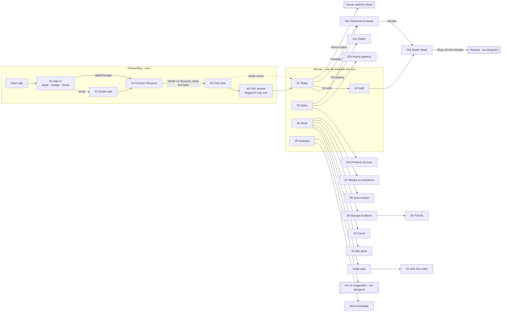

# Navigation

Derived from the **App flow** artboard and the links between artboards on the Cross-platform page.

## Graph

## Rules

- Tab bar order: **Today, Sales, Staff, Stock, Assistant**. Active tab: dark label + 3 px accent
  bar at the top edge of the tab.
- Detail screens show a back arrow with an accessible label (*Back to Sales*) and keep the parent
  tab highlighted (e.g. 02b keeps **Sales** active).
- Shortcuts across tabs: Today opens Staff (*On shift*), Tables (*Occupancy*) and Discounts &
  losses (*Possible loss*). Discounts & losses opens Waiter detail.
- The selected venue (or *All venues*) is global state, shared by all tabs.
- Entry points to S4–S7 inside the Stock tab are **not designed** (only Order plan / Idle stock /
  Count are segmented tabs). Proposed: a stock overflow menu or list; confirm with design.

## Deep links (proposed)

| Link                                  | Opens                       |
|---------------------------------------|-----------------------------|
| `onemind://auth/storyous/callback?...`   | Return from Storyous OAuth  |
| `onemind://auth/email?code=...`          | Magic-link fallback (opt.)  |
| `onemind://today`                        | Today                       |
| `onemind://staff/{staffId}`              | Waiter detail               |
| `onemind://stock/invoices/{invoiceId}`   | Invoice approval (push)     |

Scheme: `onemind://`. Universal links / App Links need a domain we own (later).
